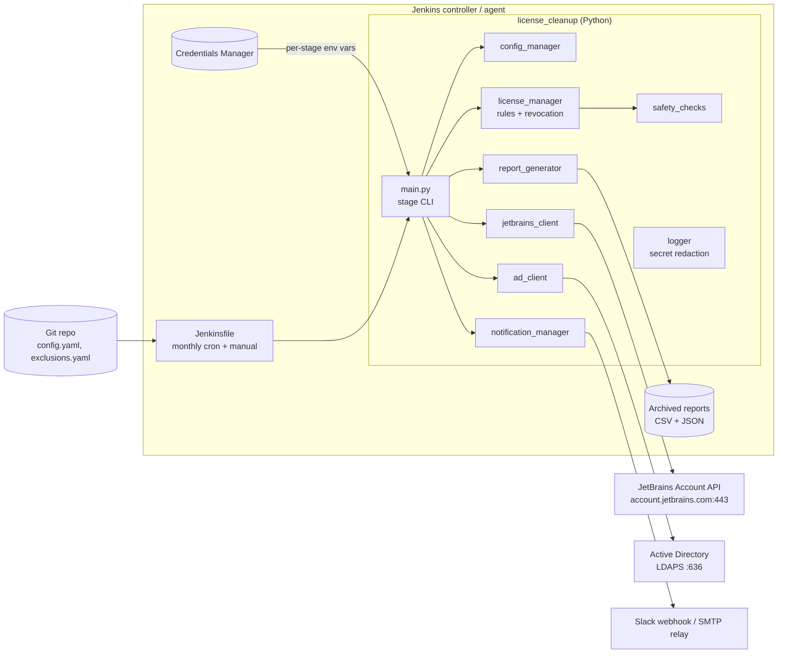
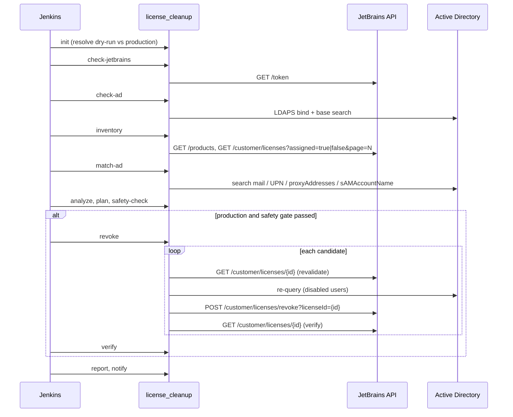
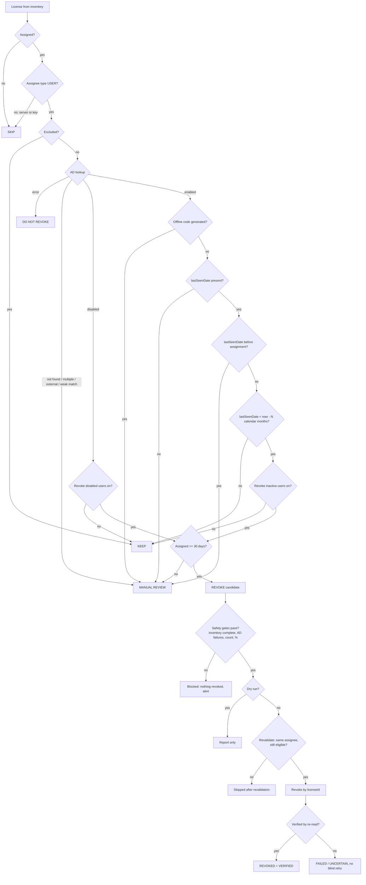

# Architecture

## Integration choice

Organizations buy and assign JetBrains licenses in **JetBrains Account** (managed through the JetBrains Console). This is the system of record for named-user licenses, and it has an official REST API:

| Need | Official API support (JetBrains Account API, `https://account.jetbrains.com/api/v1`) |
|---|---|
| Products | `GET /products` (dictionary) plus product info on every license |
| Licenses, users, emails, license IDs | `GET /customer/licenses` / `GET /customer/teams/{teamId}/licenses` (`licenseId`, `product`, `team`, `assignee.email`, `assignee.name`) |
| Assignment date | `lastSeen.lastAssignmentDate` |
| Last usage | `lastSeen.lastSeenDate` (per license), `lastSeen.isOfflineCodeGenerated` |
| Revoke one license | `POST /customer/licenses/revoke?licenseId=...` (only if assigned for at least 30 days) |
| Verify | `GET /customer/licenses/{licenseId}` |
| Pagination | `page`, `perPage` query parameters; `Link`, `X-Total-Count` headers |
| Auth | `X-Api-Key` (token) and `X-Customer-Code` headers |

**License Vault** (floating licenses, `https://<company>.fls.jetbrains.com`, Bearer token) and **IDE Services** have their own API. Its endpoint specification is only available inside the License Vault admin UI and could not be verified, so it is not implemented. If your organization uses License Vault, those licenses show up in the Account API with assignee type `SERVER` and are skipped. See [jetbrains_setup.md](jetbrains_setup.md#how-to-tell-which-product-you-use).

No browser automation is used.

## Component diagram

## Pipeline data flow

Each Jenkins stage calls one CLI sub-command. State passes between stages as JSON files in `$WORKSPACE/.state` (mode 700/600, deleted by `cleanWs`).

## Business logic flowchart

## Key design decisions

- **Per-license evaluation.** Usage is recorded per license, so each product assignment is judged independently. A disabled user loses every eligible license; an enabled user loses only the stale ones.
- **Safe defaults.** Dry run unless the reviewed config sets `production_enabled: true`; scheduled runs read only `scheduled_mode` from the config and ignore build parameters.
- **Fail closed.** Incomplete pagination, schema surprises, AD connection/auth failures, excessive lookup failures or too many candidates stop all revocations. Missing data never becomes a revocation.
- **Single-license writes.** Revocation always passes `licenseId` and never `email` (which would revoke all of a user's licenses).
- **No blind retries on writes.** Timeouts and 5xx on revoke are treated as *uncertain*, and the license is re-read to learn the actual state.
- **Idempotent.** Re-running revalidates against live data: already-revoked licenses are skipped, reassigned licenses are left alone, and a license ID is attempted at most once per run.
- **Read-only AD.** The AD client only binds and searches (`read_only=True`), escapes all filter values and requires certificate validation.
